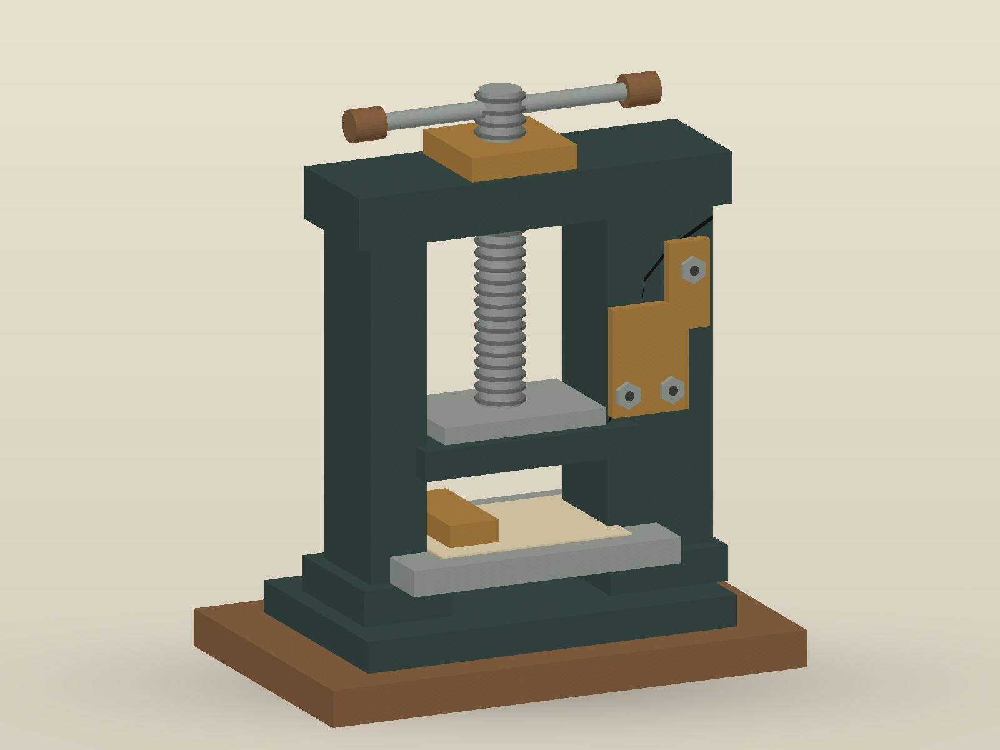

# Les petites machines en service

Halle des Petites Machines — exposition du 18 au 20 avril 2026.

## La presse manuelle à tickets

Une presse de comptoir remise en service pour les démonstrations d’impression. Le bâti a été conservé, avec sa fente ancienne sur le montant droit et une reprise mécanique rapportée.

Vue d’installation conservée par le fonds de la Halle — illustration.

## Contributeurs au dossier

Chantier et présentation : carnets et publications d’Éclisse et d’Éclisse-Nord.

Les interventions et prêts sont détaillés dans le [compte rendu](COMPTE_RENDU.md). Le [bulletin des résidences](RESIDENCES.md) conserve les affectations professionnelles en cours.

[Fonds de la Halle](README.md) · [Crédits](CREDITS.md)
